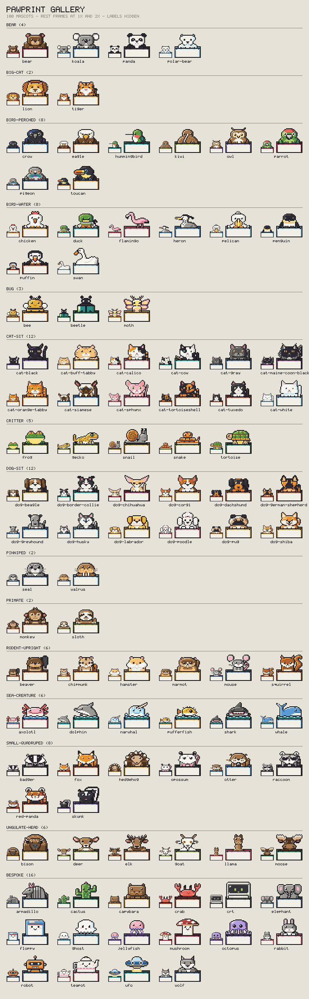
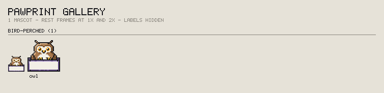
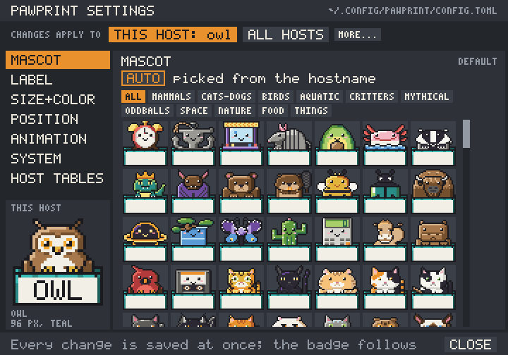

# PAWPRINT

**Know which machine you're on.** PAWPRINT puts a tiny pixel-art animal in a
shipping crate in the corner of your screen, stamped with the machine's name.
Remote into `moose` and there's a moose. Switch to `owl` and an owl slowly
turns its head to look at you.

```
      ,_,                     ____
     (O,O)                  ^ /    \ ^          (=^.^=)
     (   )                  ( o  o )            (  w  )
  ┌──"─"──┐              ┌───\    /───┐       ┌────────┐
  │  OWL  │              │   MOOSE    │       │ BUILD7 │
  └───────┘              └────────────┘       └────────┘
```
*(Real art is 32×32 pixel sprites: see [all 214 mascots](#the-214-mascots).
This is the idea in ASCII.)*

- **Always on top, never in the way.** Clicks go straight through it, it never
  steals focus, and it stays out of the taskbar, Dock, and Alt-Tab. When a
  window goes fullscreen (a remote desktop, a video), the badge steps aside.
- **Works through any remote desktop.** RDP, VNC, Jump Desktop, Parsec,
  Apollo/Moonlight. It runs on the machine you're looking at, so whatever you
  connect with shows it.
- **Picks the right animal automatically.** A host named `owl`, `owl-02`, or
  `prod-owl.lab.example` gets the owl. Names with no animal in them still get
  their own consistent mascot.
- **214 animated mascots built in**: animals, mythical creatures, planets,
  food, and gadgets, all replaceable with your own art.
- **Calm and light.** A short animation every 8–20 seconds, then it sleeps.
  Static mode turns animation off.
- **Private.** No telemetry, no keyboard or mouse monitoring, and no
  network access unless you ask: the only thing that goes online is
  **Check for updates**, when you choose it. macOS never asks for special
  permissions.

Runs on **Windows 10/11**, **macOS 13+**, and **Linux**: X11, KDE Plasma 6
on Wayland, and GNOME on Wayland (Ubuntu 24.04 LTS and newer).

> **Status: pre-release.** Everything in this README is implemented and
> tested in CI on Linux, macOS, and Windows. What remains before 1.0 is the
> first published release (until then, build from source: see
> [Development](#development)) and the owner's checks on real hardware.
> See [`ROADMAP.md`](ROADMAP.md) for what's left and [`SPEC.md`](SPEC.md)
> for the design.

---

## The 214 mascots

Eleven packs. Animals: mammals, cats and dogs, birds, aquatic, and
critters. Mythical creatures: a dragon, a unicorn, a phoenix, Cerberus,
Nessie, and more. And things with faces: oddballs, space (every planet
worth naming a server after), nature, food, and things. A machine named
`saturn`, `pizza`, or `dragon-01` gets that mascot. Each one has its own
signature move, a rare one that turns up about once an hour, and a few
shared ones (blinks, glances, a doze at night). Here they are at actual size and 2×, grouped by
body plan, with labels hidden:



<details>
<summary>The same sheet with every animation playing (2.6 MB GIF)</summary>



</details>

`pawprint list` prints them all with their aliases (`--category birds`
narrows it), and `pawprint render <id> --out badge.png` draws one.

---

## Install

Install PAWPRINT **on each machine you want to identify**, the remote
machines, not the one you connect from. Installation is per user and needs
no admin rights.

**Linux and macOS**

```sh
curl -fsSL https://github.com/nealhardesty/pawprint/releases/latest/download/install.sh | sh
```

**Windows (PowerShell)**

```powershell
irm https://github.com/nealhardesty/pawprint/releases/latest/download/install.ps1 | iex
```

The installer downloads the right build for your system, verifies its
checksum, installs it, sets it to start when you log in, and starts it. The
badge should appear in the top-right corner of your primary display.

<details>
<summary>Installer options</summary>

| `install.sh` | `install.ps1` | Effect |
|---|---|---|
| `--version 1.2.0` | `-Version 1.2.0` | Install a specific version (default: latest) |
| `--archive ./pawprint-….tar.gz` | `-Archive .\pawprint-….zip` | Install from a downloaded archive, with no network access. Its `.sha256` file is checked if it sits next to it |
| `--no-autostart` | `-NoAutostart` | Don't start at login |
| `--no-start` | `-NoStart` | Don't start it now |
| `--prefix DIR` | `-Prefix DIR` | Install somewhere other than `~/.local/bin` (Windows: `%LOCALAPPDATA%\Programs\pawprint`) |
| `--uninstall [--purge]` | `-Uninstall [-Purge]` | Remove PAWPRINT (`purge` also deletes your config) |

The environment variables `PAWPRINT_VERSION` and `PAWPRINT_PREFIX` work
like `--version` and `--prefix`. `PAWPRINT_DOWNLOAD_BASE` replaces
`https://github.com/nealhardesty/pawprint/releases`, for a mirror laid out
the same way (`download/v<version>/<asset>`, with `latest` redirecting to
`tag/v<version>`); the tests use it to point at a local server.

To upgrade later, pick **Check for updates** in the tray menu, or run
`pawprint update` ([Updating](#updating)). Re-running the installer does
the same thing: it checks the download first, then stops the running
badge, replaces the binary, and starts it again. A failed download or
checksum changes nothing. Your config is never touched.
Without a desktop session (over SSH, say) the badge can't start yet; the
installer says so and the badge starts at your next graphical login.

Passing options through a pipe:

```sh
curl -fsSL https://github.com/nealhardesty/pawprint/releases/latest/download/install.sh | sh -s -- --no-autostart
```

```powershell
& ([scriptblock]::Create((irm https://github.com/nealhardesty/pawprint/releases/latest/download/install.ps1))) -NoAutostart
```
</details>

<details>
<summary>Manual install</summary>

Download the archive for your platform and its `.sha256` file from the
[releases page](https://github.com/nealhardesty/pawprint/releases), check the
hash, put `pawprint` (plus `pawprintw.exe` on Windows) somewhere on your
`PATH`, then run:

```sh
pawprint autostart on
pawprint
```

On macOS, a binary downloaded **with a browser** is quarantined by
Gatekeeper. Clear that with `xattr -d com.apple.quarantine ./pawprint`. The
curl installer doesn't have this problem.

On macOS, `pawprint autostart on` adds a LaunchAgent
(`~/Library/LaunchAgents/io.github.nealhardesty.pawprint.plist`) and starts
the badge right away. macOS says "Background Items Added" and lists it under
System Settings → General → Login Items.
</details>

Install locations: `~/.local/bin/pawprint` on Linux and macOS, and
`%LOCALAPPDATA%\Programs\pawprint\` on Windows (added to your user `PATH`).

---

## Everyday use

| You want to... | Do this |
|---|---|
| Start it | `pawprint` (it starts automatically at login after install) |
| Change any setting | Tray/menu-bar icon → **Settings…**, or `pawprint settings` ([below](#the-settings-window)) |
| Move it | Tray/menu-bar icon → **Move**, or `pawprint move`. A dashed outline shows it's ready: drag the badge, then let go. **Esc** cancels. |
| Put it back in the corner | `pawprint reset-position` |
| See why it chose that animal | `pawprint explain` |
| Pick a different animal | `pawprint list`, then `pawprint set mascot otter` |
| Change the label | `pawprint set label "BUILD-7"` (or `none` to hide it) |
| Make it bigger or smaller | Tray → **Size**, or `pawprint set size 128` (presets: 32, 64, 128) |
| Stop the animation | Tray → **Animation ▸ Static**, or `pawprint set animation static` |
| Undo a `set` | `pawprint unset size` (any key) |
| Change the crate color | `pawprint set accent teal` (`pawprint list --accents` shows them all) |
| Preview a mascot | `pawprint preview walrus` opens a window that plays every animation; Esc closes it |
| Update to the latest release | Tray → **Check for updates**, or `pawprint update` ([below](#updating)) |
| Stop it | `pawprint quit`, or tray → **Quit** |
| Start it at login | `pawprint autostart on` (`status` shows what is registered) |
| Stop it starting at login | `pawprint autostart off` |
| Find out what's wrong | `pawprint doctor` |

**Why "move mode"?** The badge lets every click pass through to whatever is
underneath, so it never blocks a button you need. To drag it, you first ask
it to hold still. Move mode ends when you let go, when you press Enter or
Esc, or after 30 seconds. The arrow keys nudge it by a pixel (Shift: ten)
while move mode is on, and the keyboard goes to the badge until it ends.
Its position is anchored to the nearest corner or edge, so it stays put
when a remote session changes resolution. (On Wayland, clicks anywhere
else on the screen are held back while move mode is on.)

### How it picks a mascot

1. **Your setting**, if you've chosen one.
2. **The mascot in the name.** `owl`, `owl-02`, `prod-owl.example.com`,
   `polar-bear-3`, `saturn`, and `pizza-oven` all match. Whole words only:
   `snowless` doesn't get an owl. A machine named after a mascot added in
   a later version switches to it when you upgrade.
3. **Otherwise, a consistent pick.** The hostname is hashed to pick one of
   the mascots and a crate color. The same name gives the same result on
   every install, and once chosen it is remembered, so adding new mascots
   later won't change your machines.

`pawprint explain` shows every step:

```
$ pawprint explain
hostname    prod-owl-02.lab.example
short name  prod-owl-02
label       PRODOWL02              (auto: short hostname, letters and digits, upper case)
mascot      owl                    (rule 3: token "owl")
accent      violet                 (from mascot)
size        64                     (default)
position    top-right +16+16       (dragged; saved in state file)
backend     wayland (layer-shell, KDE Plasma)
```

---

### Updating

PAWPRINT never checks for updates by itself. When you want to know, choose
**Check for updates** in the tray menu and watch the crate:

| The crate says | What it means |
|---|---|
| `CHECKING` | Asking GitHub what the latest release is |
| `UP TO DATE` | You have it. Your mascot celebrates |
| `NEW 1.3.0` | There is a newer release, and the menu item is now **Install update 1.3.0** |
| `UPDATING` | You chose it: downloading, verifying, and swapping the binary |
| `UPDATED` | The new version is running |
| `FAILED` | Offline, or the download didn't verify. Nothing was changed; the log (`pawprint paths`) says why |

A few seconds later the hostname is back. From a terminal it is one
command:

```sh
pawprint update --check   # only say whether there is a newer release
pawprint update           # install it, and restart the badge if it was running
```

An update is the installer again, carried inside the binary: the same
checksum check, the same "change nothing unless it all worked", and it
updates PAWPRINT wherever you installed it. Your config, your position,
and your autostart setting stay as they are.

## The settings window



**Tray → Settings…** (or `pawprint settings`) opens a window with a control
for every option in the config file: the mascot (all 214, by category, or
type to search and press Enter), the label, its letter case and text size,
the size, the crate color, the corner, the distance from the edge, the
display, the animation and its timing, the tray icon, what to do when a
window goes fullscreen, and the backend.

- **Changes are saved as you click,** and the running badge updates at
  once, so the badge in the corner of your screen is the preview. Hover a
  choice to see it on the window's own badge first. **Undo** (Ctrl+Z,
  ⌘Z on macOS) steps back through everything you changed.
- **Changes apply to** this machine by default (the same place
  `pawprint set` writes). Switch to **All hosts** to change the default for
  every machine that shares the file, or open any `[hosts]` section from
  **Host tables**, where you can also add, rename, and delete them.
- **Each setting says where its value comes from:** set here (with
  **Clear** to take it back out), or inherited from all hosts, a matching
  host section, or the default. If a stronger section overrides it on this
  machine, it says so.
- Your comments and formatting are kept, exactly as with `pawprint set`. A
  config file with a syntax error is shown, never rewritten.

Esc, ⌘W/Ctrl+W, or **Close** closes it.

---

## Configuration

Everything works without a config file. When you want one,
`pawprint config init` writes a commented starter file, and
`pawprint config path` tells you where it lives:

| OS | Config file |
|---|---|
| Linux | `~/.config/pawprint/config.toml` |
| macOS | `~/Library/Application Support/pawprint/config.toml` |
| Windows | `%APPDATA%\pawprint\config.toml` |

The running badge picks up changes on its own. `pawprint reload` forces it.

```toml
mascot = "auto"          # "auto" or a mascot id from `pawprint list`
label = "auto"           # "auto" (short hostname) | "full" | "none" | any text
label_case = "upper"     # "upper" | "lower" | "as-is"
label_size = "auto"      # "auto" (tallest that fits) | "small" | "medium" | "large"
size = 64                # mascot size in pixels: 32, 64, 128 (any multiple of 32)
position = "top-right"   # top-left, top, top-right, left, center, right, bottom-left, bottom, bottom-right
offset = [16, 16]        # pixels in from that corner or edge
display = "primary"      # or an output name from `pawprint doctor`
animation = "idle"       # "idle" | "static"
interval = [8, 20]       # seconds between idle animations
accent = "auto"          # crate color: "auto", a name, or "#rrggbb"
tray = true              # show the tray / menu-bar icon
fullscreen = "hide"      # "hide": step aside for fullscreen windows | "show": stay on top
backend = "auto"         # leave this alone unless `pawprint doctor` says otherwise
```

**Fullscreen windows.** When a window covers the whole display the badge
is on (a remote desktop client such as Remote Desktop Connection in full
screen, a video, a game), the badge hides and comes back when that window
leaves fullscreen or the front. That way your local machine's badge never
sits on top of a remote machine's desktop (the remote machine shows its
own). Set `fullscreen = "show"` to keep it on top anyway.

**The label always fits on the crate.** The badge is exactly `size` ×
`size` pixels, label included. PAWPRINT sets the label in the tallest text
that fits the whole name, switching to a tiny 3×5 font for long names, and
if even that is too wide it shows as much of the start of the name as fits
(at size 32, `JENKINSAGENTLINUX07` shows `JENKIN`). A label from the
hostname keeps only letters and digits, so more of it fits (`prod-owl-02`
shows `PRODOWL02`), and at most its first 20 characters. A `label` you set
yourself is shown exactly as you wrote it. `label_size` caps the text
height (`small` 7, `medium` 14, `large` 21 px) if you'd rather it not grow
with the badge.

### One config for every machine

Settings can target specific hosts, so you can copy **the same file to every
machine**. Each machine applies the sections that match its short hostname.
Patterns can use `*` and `?`.

```toml
size = 64

[hosts.buildbox]
mascot = "capybara"
label = "BUILD"

[hosts.lab-mini]
mascot = "cat-maine-coon-black"

[hosts."prod-*"]
accent = "cranberry"     # every production box gets a red crate
```

`pawprint set <key> <value>` writes into the current host's section
(`[hosts.<short hostname>]`) for you, keeps your comments and formatting,
checks the value first, and tells the running badge. The tray's **Size**
and **Animation** choices are saved the same way, so they survive a
restart; `pawprint unset <key>` takes one back out. Because they go into
this host's own section, they win over patterns and top-level settings, and
copying the file to another machine doesn't carry them over.

The tray menu (the menu bar on macOS): **Move**,
**Size ▸ 32/64/128**, **Animation ▸ Idle/Static**, **Settings…**,
**Reset position**, **Reload config**, **Check for updates**, **Quit**.
Set `tray = false` to hide it.

A dragged position is saved separately (in PAWPRINT's state file) so your
config file is never rewritten behind your back. `pawprint reset-position`
clears it.

---

## Custom mascots

Every mascot can be replaced, and you can add your own. The easiest route is
a PNG sprite strip:

```sh
pawprint mascot export owl ./owl     # start from a built-in: ./owl/mascot.toml + ./owl/sprite.png
# ...edit ./owl/sprite.png in Aseprite, LibreSprite, Piskel, etc...
pawprint mascot check ./owl          # validate it with the same rules as the build
```

Then copy the folder into the `mascots` folder next to your config file
(`pawprint paths` shows exactly where, e.g. `~/.config/pawprint/mascots/owl/`).
**A folder with the same id as a built-in replaces it. A new id adds a new
mascot**: change `id` in `mascot.toml` and name the folder the same, then
select it with `pawprint set mascot <id>` or match it by hostname through its
`aliases` (yours win if they clash with a built-in's; `mascot check` warns).

`pawprint list` shows where each mascot comes from in its SOURCE column:
`bundled`, `user` (one you added), or `override` (yours, replacing a
built-in). A mascot with a mistake in it is skipped with a warning (in
`pawprint explain`, `pawprint list`, and the log) and never stops the badge.
The badge reads the folder when it starts and again on every reload, so
`pawprint reload` (or `pawprint set mascot <id>`, which reloads) picks up a
new or changed mascot.

The rules, briefly:

- `sprite.png` is a horizontal strip of **32×32 frames**.
- Pixels are either fully opaque or fully transparent (no soft edges).
- Keep the face in the top 20 rows. The bottom 12 rows are behind the crate.
- `mascot.toml` names a rest frame and one or more short actions. Each
  action lists frame numbers, and each frame shows for `duration_ms`
  (80–2000 ms; at most 4 s per action), so repeat a number to hold a frame:

```toml
id = "my-owl"
name = "My Owl"
category = "birds"
aliases = ["hooter"]
accent = "violet"
sprite = "sprite.png"
rest = 0

[[actions]]
name = "blink"
frames = [1, 0]
duration_ms = 200
```

The built-in mascots are written in a **text pixel format** instead: pixel
grids in TOML, with shared body bases, reusable motions like `blink` and
`duck`, and props like `zzz`. Your own mascots can use it too, and it's the
way to contribute new built-ins. Both formats are documented in
[SPEC.md §12](SPEC.md#12-mascot-assets), and [docs/ART.md](docs/ART.md) walks
through drawing one on a shared body base, step by step.

---

## Remote desktop notes

- **Install on the remote machine**, the one whose name you want to see.
- **Full-screen remote sessions:** if PAWPRINT also runs on the machine
  you connect *from*, its badge hides while the remote session is full
  screen, so you only see the remote machine's badge. In a window, both
  show.
- **Windows RDP:** each RDP session gets its own badge, started when you log
  in. A console session and an RDP session on the same machine each have
  their own.
- **Linux RDP and VNC (xrdp, Xvnc):** these sessions are usually X11 even if
  your desktop normally runs Wayland. PAWPRINT handles that automatically.
  If your session's window manager doesn't run autostart entries, start it
  with `pawprint`.
- **Parsec, Apollo/Moonlight, and Jump Desktop** stream the real screen, so
  the badge is in the stream. If a virtual display becomes primary while you
  are connected, the badge follows it.
- **Ubuntu / GNOME on Wayland:** works out of the box, including GNOME Remote
  Desktop's RDP and VNC (both "desktop sharing" and "remote login"). If you
  use **fractional scaling** (125%, 150%, ...), the badge can look blurry;
  `pawprint doctor` prints the one-line `gsettings` fix. The tray icon
  appears on Ubuntu. On GNOME without the AppIndicator extension, use the
  `pawprint` commands instead.

---

## Troubleshooting

Run **`pawprint doctor`** first. It reports the session type, which backend
was chosen and why, your displays and which one is primary, transparency
support, autostart status, and any config problems. For example, on a
Linux X11 session with no compositor:

```
$ pawprint doctor
...
Backend
  backend             x11
  why                 DISPLAY is set
  window manager      Openbox
  compositor          none
  ARGB visual         yes
  transparency        bounding shape from the badge mask (pixel-identical)
  RandR monitors      yes (1.5)
  display             DP-1 1920x1080+0+0 scale 1 usable 1920x1040+0+40 (primary)  <- badge
  tray                StatusNotifierItem host available

No problems found.
```

On Linux, PAWPRINT picks its backend like this: a Wayland compositor with
layer-shell (KDE Plasma, Sway, Hyprland, ...) gets the native Wayland
backend; GNOME on Wayland uses X11 through XWayland; anything else with
`DISPLAY` set (X11 desktops, xrdp, Xvnc) uses X11. Set `backend = "x11"` or
`"wayland"` in the config only if `doctor` suggests it.

| Problem | Try |
|---|---|
| Nothing appears | `pawprint status`. If it isn't running, `pawprint run --verbose` shows errors in the terminal. Exit code 3 means no usable graphical session was found. |
| Black or gray box instead of transparency (Linux X11) | No compositor is running. PAWPRINT should switch to shaped mode automatically; `doctor` shows which mode is in use. |
| It's on the wrong monitor | `pawprint doctor` lists output names; set `display = "<name>"`. |
| Blurry on Ubuntu/GNOME with fractional scaling | Run `pawprint doctor`; it shows the `gsettings` command that makes it crisp. |
| It's behind a fullscreen game | Exclusive-fullscreen apps draw over everything. Use borderless windowed mode. |
| Wrong animal | `pawprint explain` shows the rule that fired; `pawprint set mascot <id>` overrides it. |
| Want a fresh fallback pick | `pawprint forget` clears this host's remembered choice. |
| "already running" but nothing visible | It's running in a different session (for example the console vs. RDP). `pawprint quit` from that session, or log out of it. |

Logs: `pawprint paths` shows the log file location (on Linux,
`~/.local/state/pawprint/pawprint.log`; it is capped at 1 MB, with one
older file kept as `pawprint.log.1`).

---

## Uninstall

```sh
curl -fsSL https://github.com/nealhardesty/pawprint/releases/latest/download/install.sh | sh -s -- --uninstall
```

```powershell
& ([scriptblock]::Create((irm https://github.com/nealhardesty/pawprint/releases/latest/download/install.ps1))) -Uninstall
```

Your config and custom mascots are kept. Add `--purge` / `-Purge` to delete
them too. If you installed with `--prefix`, pass the same `--prefix` to
uninstall. From a checkout, `make uninstall` does the same.

---

## Development

PAWPRINT is Rust, with a small native window backend for each platform and
everything else written once in a shared, platform-independent core. Art is
text too: every mascot is a pixel grid in TOML, compiled at build time. Read [`SPEC.md`](SPEC.md)
before changing anything and [`ROADMAP.md`](ROADMAP.md) before proposing new
work. Contributor rules for humans and coding agents are in
[`AGENTS.md`](AGENTS.md).

### Prerequisites

| OS | Install |
|---|---|
| All | [rustup](https://rustup.rs). The pinned toolchain and targets install on first build. |
| Linux | `make`. Static musl release builds for x86_64 and aarch64 link with the `rust-lld` that rustup ships, so there is no cross toolchain to install. |
| macOS | Xcode Command Line Tools: `xcode-select --install` (provides `make`, `lipo`, `codesign`) |
| Windows | Visual Studio Build Tools (C++ workload) and GNU Make: `winget install ezwinports.make`. Run targets from PowerShell. |
| Publishing | [GitHub CLI](https://cli.github.com), authenticated with `gh auth login` |
| Installer checks (optional) | `make lint-installers` needs `shellcheck`; `make release` on Linux runs the aarch64 binary if `qemu-aarch64` is installed. On Ubuntu: `sudo apt-get install shellcheck qemu-user` |
| Linux display tests (optional) | `make test-x11` and `make test-wayland` drive real display servers (and `make power-check` uses Xvfb). On Ubuntu: `sudo apt-get install xvfb xcompmgr openbox sway swaybg grim foot wtype dbus` |
| Windows display test (optional) | `make test-windows-display` runs the badge on your own desktop: nothing to install, but quit any running badge first and leave the mouse alone for a few seconds |

### Make targets

**Everything goes through `make`.** Run `make` on its own to list targets.
The targets are the same on Linux, macOS, and Windows, and CI runs the same
ones.

To try the badge from a checkout, `make run` runs it in the foreground
(Ctrl-C or `pawprint quit` stops it). After `make build`, the CLI is
`target/debug/pawprint`: bare `target/debug/pawprint` starts the badge in
the background, and `target/debug/pawprint move`, `status`, and `quit` talk
to it. On Windows the build also makes `target\debug\pawprintw.exe`, the
windowless twin that bare `pawprint` starts so no console window opens.

| Target | What it does |
|---|---|
| `make help` | List targets (what `make` on its own runs) |
| `make build` | Debug build |
| `make run` | Build and run the badge in the foreground (`ARGS="--verbose"` passes flags) |
| `make preview MASCOT=owl` | Open a window with one mascot cycling through all its animations (`SIZE=64` for another size) |
| `make settings` | Open the settings window from the local build (it edits your real config file) |
| `make power-check` | Build the release badge and measure startup time, CPU and wakeups in idle and static mode, memory, and binary size against the power budget (`POWER_SECONDS=120` per mode). Linux: under Xvfb. Windows: on your desktop, with your config and state files backed up next to them (`*.pawdev-backup`) and put back afterwards, or at the next run if one was interrupted. macOS: on your desktop with a private HOME, from a universal binary. CI jobs run it on `windows-latest` and `macos-latest` |
| `make test` | Unit tests, golden image tests, and mascot catalog validation |
| `make test-x11` | Linux: run the badge under Xvfb (bare, with the `xcompmgr` compositor, with the `openbox` window manager) and check its pixels, click-through, move mode and its outline, single instance, the tray menu over a private D-Bus (including **Check for updates** against a local release server), `set`/`unset` and reloads, hiding under a fullscreen window, the preview window, and the settings window |
| `make test-wayland` | Linux: run the badge under headless Sway and check placement, click-through, move mode, panels, output changes, fullscreen windows covering it, and the preview and settings windows from screenshots |
| `make test-linux-display` | Both display-server suites (a separate CI job runs this) |
| `make test-macos-display` | macOS: run the badge in your logged-in desktop and check its window level, placement, IPC, menu-bar item, `autostart` against launchd, and the preview and settings windows, and (with Screen Recording and Accessibility granted to the terminal) pixels, drag, keys, and a menu choice; a CI job runs it on `macos-latest` |
| `make test-windows-display` | Windows: run `pawprintw.exe` on this desktop and check its window styles, top-right placement, topmost, click-through, a real move-mode drag, work-area changes, the named pipe, its pixels on screen, the tray icon and a real click through its menu, `autostart` writing the `Run` value, hiding under a fullscreen window, and the preview and settings windows (a separate CI job runs this on `windows-latest`). It restores your state file, config file, and autostart value afterwards |
| `make check-assets` | Validate the mascot catalog only |
| `make lint` | Format check and clippy (warnings are errors) |
| `make fmt` | Format the code |
| `make golden` | Regenerate golden images after an intentional rendering change |
| `make golden-hosts` | Recompute `tests/golden/hostnames.tsv`, the catalog stability fixture (200 hostnames and the mascot each gets), after an intentional catalog change; review the diff, since it moves real machines |
| `make contact-sheet` | Render every mascot (labels hidden, grouped by body base) into `docs/gallery.png`; `ANIMATED=1` also writes `docs/gallery.gif` with every action playing (sampled every 100 ms) |
| `make building-blocks` | Render the crate in every accent, every prop, and every body base with every motion template into `docs/building-blocks.png` |
| `make settings-shots` | Render every page of the settings window into `out/settings/` for review, and the mascot page into `docs/settings.png` (the screenshot above) |
| `make palette` | Regenerate `assets/palette.gpl`, the master palette for GIMP, Aseprite, and LibreSprite |
| `make art-export MASCOT=owl` | Export a mascot's layers (one PNG each) and frames into `out/art/<id>/` for editing in a pixel-art tool |
| `make art-import MASCOT=owl PNG=out/art/owl/eyes.png` | Print an edited PNG layer as a ready-to-paste grid in the mascot's own glyphs |
| `make mascot-sheet DIR=path/to/mascots` | Render every mascot folder in `DIR` frame by frame into `out/mascot-sheet/` (rest at 1×, 2×, and 4× on light and dark, then every action), with the same checks as the build; works on your own custom mascots too |
| `make ci` | Everything CI checks (`lint` + `test`) |
| `make release` | Optimized build for this OS, checked and run: static musl x86_64 and aarch64 on Linux (the aarch64 one runs under `qemu-aarch64` if installed), a universal binary re-signed ad hoc on macOS, `pawprint.exe` and `pawprintw.exe` on Windows |
| `make package` | Release build, then the archives and their `.sha256` files into `dist/`. Fails if the catalog has fewer valid mascots than `assets/catalog.toml` requires (214) or is missing a required one. |
| `make publish` | Upload `dist/` and the installers to the GitHub release `v<version>`, creating it as a draft if needed. Refuses unless the tree is clean, the tag is on `HEAD`, and `dist/` was packaged from that commit. `make publish DRY_RUN=1` prints the `gh` commands without running them |
| `make release-finalize` | Once every OS has published: check the draft release has all four archives, their `.sha256` files, and both installers, then publish it. `DRY_RUN=1` prints the commands and the expected assets |
| `make install` | Package, then install that build for this user through the real installer (`--archive dist/...`): autostart on, badge started |
| `make uninstall` | Remove the install and autostart through the installer (config is kept) |
| `make test-install` | Package, then run the installers end to end in a throwaway home under every shell found (`sh`, `dash`, `bash`; `powershell`, `pwsh`): fresh install, upgrade from a local HTTP server, `pawprint update` finding and installing a newer release, a checksum mismatch that must change nothing, uninstall, purge. On Windows and macOS the autostart entry is your real one, so it refuses to run while `pawprint autostart status` says on (outside CI) |
| `make lint-installers` | `shellcheck` the POSIX installer (needs `shellcheck`) |
| `make doctor` | Run `pawprint doctor` from the local build |
| `make clean` | Remove build outputs |
| `make check-all-targets` | Type-check the workspace for every release target (Windows, macOS, Linux musl) from any OS; needs no linkers |
| `make spike-f22` | Rebuild the F22 spike: proves the Linux window, Wayland, D-Bus, and tray crates link into fully static musl binaries |

`make check-assets` and `make test` report the catalog gates (at least 214
mascots, every showcase mascot present) without failing; only `make package`
enforces them.

### Releasing

A release is one tag push:

1. Bump `version` in the root `Cargo.toml` and commit to `master`.
2. Tag and push: `git tag v<version> && git push origin v<version>`.
3. The **Release** workflow does the rest with the same make targets: Linux
   runs `make package && make publish` (creating a draft release), then
   macOS and Windows do the same, then `make release-finalize` checks all
   ten assets are there and makes the release public. Until then nobody
   sees it, so `latest` never lacks an OS.
4. Test the install one-liners on a clean machine of each OS.

To release by hand instead, check out the tag on each OS and run
`make package && make publish` (Linux first, so it creates the draft), then
`make release-finalize`. `make publish DRY_RUN=1` shows what would run.

`make publish` reads the version from `Cargo.toml`, so there is nothing to
pass. It refuses to run with uncommitted changes, when the tag doesn't
point at `HEAD`, or when `dist/` was packaged from another commit (recorded
in `dist/COMMIT`), so every asset matches the tagged commit.

Details are in [SPEC.md §15](SPEC.md#15-packaging-release-and-install).

---

## License

[MIT](LICENSE), code and bundled art.
