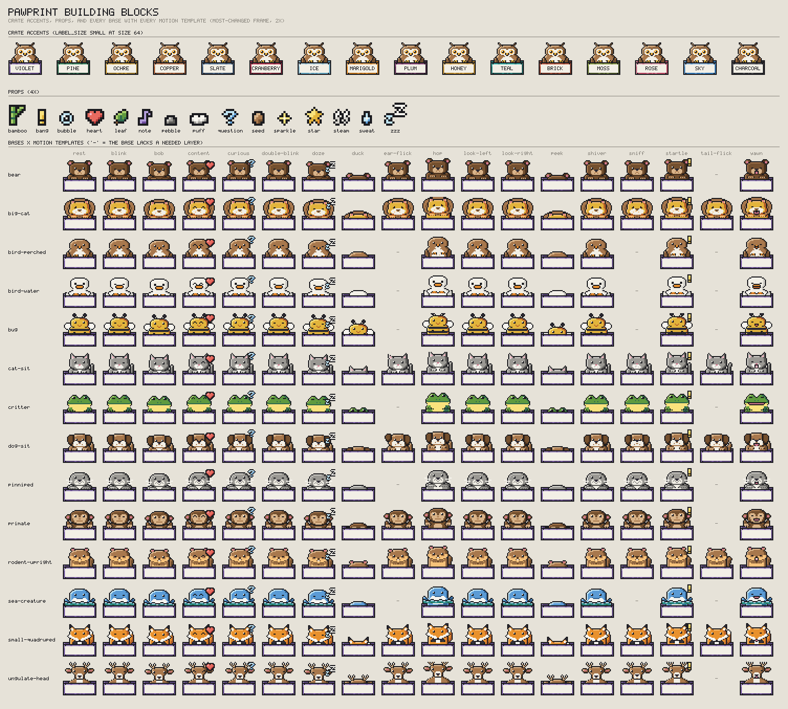
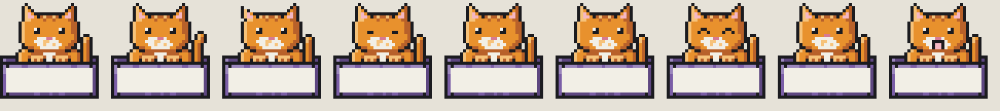
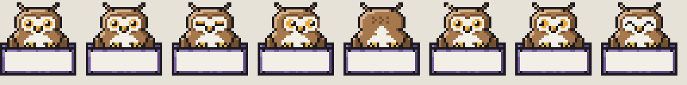

# PAWPRINT art guide

How to draw a mascot that looks like it belongs with the other 99. The rules
are in [SPEC §12](../SPEC.md#12-mascot-assets); this is the practical
version, with the things that only become obvious once you've drawn a few.



*`make building-blocks`: the crate in all 16 accents, the 15 props, and each
of the 14 bases with each motion template applied.*

## The 30-second version

1. Pick the base for your animal ([SPEC §12.8](../SPEC.md#128-bases)). Open
   `assets/bases/<base>.toml`: its header lists the role glyphs and slots.
2. Create `assets/mascots/<id>/mascot.toml` with `extends = "<base>"`, map
   the role glyphs to master palette names, and add or replace the layers
   that make your animal *that* animal.
3. Give it a template action or two and one signature action.
4. `make check-assets`, then `make contact-sheet` and look at it at 1×.

## A worked example: a tabby on `cat-sit`

[`docs/examples/tabby/mascot.toml`](examples/tabby/mascot.toml) is the
smallest useful mascot (a test keeps it compiling). It does three things:

```toml
extends = "cat-sit"

[palette]              # 1. recolor the base's roles
"l" = "orange-1"
"f" = "orange-2"
"F" = "orange-3"
"s" = "orange-3"       #    and add a glyph of your own

[layers.stripes]       # 2. add a layer; it draws after every base layer
at = [13, 5]
follows = "head"       #    and rides along when the head tilts
grid = """
s.ss.s
.s..s.
"""

[[actions]]            # 3. a template, then a signature action
use = "blink"
```



*Rest, then every variant inherited from `cat-sit`: tail flick, ear flick,
closed, left, right, and happy eyes, sniff, open mouth.*

A recolor plus stripes is the *minimum*, and on its own it would fail the
readability review against the other cats. Real catalog mascots replace or
add enough layers that their silhouette or face tells them apart.

## The reference mascot: the owl

[`assets/mascots/owl/mascot.toml`](../assets/mascots/owl/mascot.toml) is
built on `bird-perched` and shows every technique worth copying:



- **Replacing a base layer in place.** The owl's `head` replaces the base
  head, adding the cream facial disc. Same name, same drawing position.
- **A new slot.** Ear tufts are an `ears` slot the base doesn't have, so the
  `ear-flick` template works on the owl.
- **Head variants instead of custom frames.** `head.turn` draws the disc
  2 px to the right and `head.back` has no face at all. The signature head
  turn is `head=turn` plus `eyes+2,0` and `beak+2,0`; the rare night spin is
  turn → back → mirrored back (`flipx`) → mirrored turn → front. No
  full-frame grids needed.
- **Iris rings.** The base's eyes are plain 2 × 2 black with a glint. The owl
  replaces all five eye layers with 4 × 4 amber irises, keeping
  `follows = "head"`.

## Shared conventions

**Role glyphs** mean the same thing in every base:

| Glyph | Role | Glyph | Role |
|---|---|---|---|
| `.` | clear | `k` | ink: outline and pupils |
| `l` `f` `F` | main material: light, base, shadow | `w` `m` `M` | secondary (belly, muzzle, chest, disc): light, base, shadow |
| `e` | iris | `h` | eye highlight |
| `n` | nose | `p` | inner ear, tongue, mouth |
| `b` `B` | beak or bill, and its shadow | | |

Bases add their own extras (antlers, water, mane, markings) and document
them in their headers. Your mascot may add any glyph it likes.

**Standard slots**, in the usual drawing order: `tail` (+`flick`), `body`,
`head`, `ears` (+`flick`), `eyes` (+`closed`, `left`, `right`, `happy`),
`nose` (+`sniff`), `mouth.open` (hidden at rest), `paws`. Face slots follow
`head`. The templates need these exact names.

**Geometry** (rows and columns of the 32 × 32 frame):

| Rows | What lives there |
|---|---|
| 0–3 | ears, antlers, crests, and the props templates draw (top right) |
| 4–16 | the face; **eyes in rows 8–10** (`peek` shows only rows 0–10) |
| 17–19 | paws, flippers, beaks, and tails meeting the crate rim |
| 20–31 | hidden behind the crate front; keep the body going so `duck` and `hop` never show a gap |

The mascot spans roughly columns 2–29. The crate front's label strip is
rows 22–29 and is always plain cream: never rely on art showing there.

## Gotchas

- **Layer order is drawing order, and new slots go last.** A slot you add
  draws on top of *everything* in the base, paws included. To put something
  under the eyes (a facial disc, a mask), replace the base's `head` with a
  version that includes it, as the owl does.
- **`follows` is per slot.** If you replace `eyes`, replace (or check) every
  `eyes.*` variant too; they all move together. A replaced layer keeps the
  base's `follows` unless it sets its own.
- **Offsets add up along `follows`.** With eyes following head,
  `head+1,0` moves the eyes 1 px; `head+1,0` plus `eyes+1,0` moves them 2.
- **Interior lines are shadow, never ink.** The chin against the chest, the
  paws against the body, toe lines: all `F` (or `M`). Ink there reads as a
  hole, especially at 1×.
- **A layer can't erase.** Clear pixels in a layer show whatever is beneath,
  so you can't paint a base feature away from above. Replace the base layer
  that draws it (same name), or hide its slot in `rest`.
- **Symmetry by counting.** It's easy to make a row 1 px wider on one side.
  Check that each row's leftmost and rightmost opaque columns add up to 31
  for a centered animal.
- **Check every variant at 1×.** A 2 × 2 eye moved 1 px is a glance; a
  closed eye is one row of ink. Both are invisible if they land on an
  outline.
- **Sixteen colors go fast.** Ink, three fur shades, three belly shades,
  iris, glint, nose, and pink is already eleven. Props used by your actions
  count too, and several bases (bear, pinniped, ungulate-head) already sit
  at 15 with their props. Recolor onto existing glyphs before adding new
  ones.
- **Read the base header for its exceptions.** `dog-sit` has floppy ears by
  default (list `ears.prick` or `ears.fold` in `rest` instead, and redraw
  `ears.flick` to match); `big-cat`'s `mane` doesn't follow the head (a
  tiger leaves it out of `rest`); `rodent-upright` shows its `mouth` (buck
  teeth) at rest; `sea-creature` draws `water` last, in front.
- **Templates stay small.** At most 2 px of movement in a template; save the
  big moves for signature actions.

## Tools

| Command | What it's for |
|---|---|
| `make check-assets` | Validate everything; any warning in a bundled mascot is an error |
| `pawprint render <id> --size 256 --out x.png` | One badge, large, to inspect pixels (`--frame N` for other frames) |
| `make contact-sheet` | Every mascot at 1× and 2×, labels hidden, grouped by base: the squint test |
| `make contact-sheet ANIMATED=1` | The same with every action playing (`docs/gallery.gif`) |
| `make building-blocks` | Every base and every template, to pick a base and see what you inherit |
| `make art-export MASCOT=<id>` | Layers and frames as PNGs in `out/art/<id>/` for a pixel-art tool |
| `make art-import MASCOT=<id> PNG=<file>` | Back again: prints a `[layers]` table in your mascot's glyphs |
| `assets/palette.gpl` | The master palette for GIMP, Aseprite, and LibreSprite |

Every PR that touches a mascot fills in the art review checklist in the
pull request template.

## Provenance

All art is original to this repository and MIT licensed. Don't trace or
adapt sprites from games, characters, or other desktop pets.
